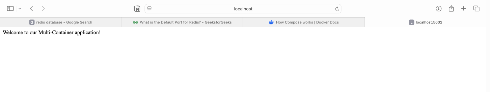
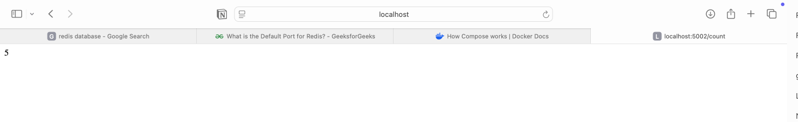
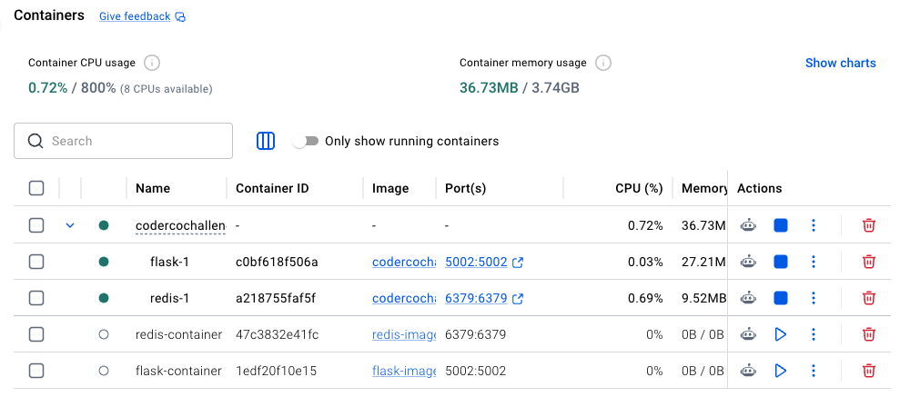
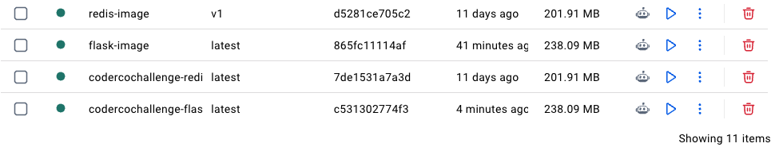

# Building a Multi-Container Application

A CoderCo Docker challenge to build a Python Flask application connected to Redis, with both services containerised and managed using Docker Compose.

## 1. Project Structure & Multiple Dockerfiles

Multi-container applications often have separate Dockerfiles because each service may require different dependencies, configurations, and startup commands.

There are two common approaches:

**1. Separate service directories (used in this project)**

- `flask/` — Contains `app.py`, `requirements.txt`, and the Flask Dockerfile.
- `redis/` — Contains the Redis Dockerfile.
- `compose.yml` — Located in the project root to manage both services.

Each service can have a file named `Dockerfile` because they are stored in separate directories.

```yaml
services:
  flask:
    build: ./flask

  redis:
    build: ./redis
```

**2. Multiple named Dockerfiles**

Alternatively, Dockerfiles can share a directory with different names, such as `Dockerfile.frontend` and `Dockerfile.backend`.

```yaml
services:
  frontend:
    build:
      context: .
      dockerfile: Dockerfile.frontend

  backend:
    build:
      context: .
      dockerfile: Dockerfile.backend
```

Here, `context` defines the build directory, while `dockerfile` specifies which Dockerfile to use.

**Key distinction:** Dockerfiles define how individual images are built, while Docker Compose manages how the services run together. Not every service needs a custom Dockerfile; prebuilt images can also be referenced using `image:`.

---

## 2. Architecture & Application Logic

The application consists of two services:

- **Flask:** Handles HTTP requests and communicates with Redis.
- **Redis:** Acts as a key-value store for the visit counter.

Docker Compose creates a shared network, allowing the services to communicate using their service names.

### Application Architecture

```text
           Browser (Mac)
                |
                | localhost:5002
                v
        +------------------+
        | Flask Container  |
        | Port: 5002       |
        |                  |
        | /       Welcome  |
        | /count  Counter  |
        +------------------+
                |
                | Redis Python client
                | redis:6379
                v
        +------------------+
        | Redis Container  |
        | Port: 6379       |
        |                  |
        | Key: visits      |
        +------------------+
                |
                | Saved database files
                v
        +------------------+
        | Docker Volume    |
        | redis-data       |
        +------------------+
```

### How the Application Works

**Welcome route (`/`)**

1. The browser sends a request to `localhost:5002`.
2. Docker forwards the request to the Flask container.
3. Flask returns the welcome message.

**Visit counter route (`/count`)**

1. The browser sends a request to `/count`.
2. Flask connects to Redis using the Python Redis client.
3. `r.incr("visits")` increments the `visits` key in Redis.
4. Redis returns the updated count to Flask.
5. Flask returns the value to the browser.

Each refresh of `/count` increments the counter.

### Container Networking

Docker Compose automatically creates a network and connects both services to it.

Flask connects to Redis using the hostname `redis` and port `6379`, supplied through environment variables.

**Important networking concepts:**

- `localhost` inside a container refers to that container itself, not the Mac or another container.
- Compose services can communicate using their service names through Docker's internal DNS.
- `5002:5002` publishes Flask's container port to the Mac, allowing browser access.
- Redis does not need a published host port because Flask connects internally using `redis:6379`.
- `depends_on` starts Redis before Flask but does not guarantee that Redis is fully ready to accept connections.

---

## 3. Implementation

### Flask Application

The Flask application contains two routes:

- `/` — Returns a welcome message.
- `/count` — Increments and returns the Redis visit counter.

The Redis connection is configured using environment variables:

```python
import os
import redis

@app.route('/count')
def redis_counter():
    r = redis.Redis(
        host=os.getenv("REDIS_HOST"),
        port=int(os.getenv("REDIS_PORT"))
    )
    return str(r.incr("visits"))
```

The `redis` Python package acts as a client that communicates with the separate Redis server.

### Dockerfiles

**Flask Dockerfile**

The Flask Dockerfile:

1. Uses a Python slim base image.
2. Sets `/app` as the working directory.
3. Copies the application files into the image.
4. Installs dependencies from `requirements.txt`.
5. Documents port `5002` using `EXPOSE`.
6. Starts Flask using `python app.py`.

**Redis Dockerfile**

```dockerfile
FROM redis:7
```

The official Redis image already contains the Redis server and its default startup command, so no additional instructions were required.

### Docker Compose

Docker Compose defines and manages both services through `compose.yml`.

The main configuration includes:

| Setting | Purpose |
|---|---|
| `build` | Builds the images using their Dockerfiles |
| `ports` | Publishes Flask's port to the Mac |
| `depends_on` | Controls service startup order |
| `environment` | Supplies Redis connection settings to Flask |
| `volumes` | Provides persistent storage for Redis |

Compose also automatically creates a shared network, eliminating the need to manually create and connect containers to a Docker network.

### Persistent Storage for Redis

A named Docker volume was added to preserve Redis's saved data independently of the container.

```yaml
redis:
  build: ./redis
  volumes:
    - redis-data:/data

volumes:
  redis-data:
```

- `redis-data` — The Docker-managed named volume.
- `/data` — The directory inside the Redis container used for database files.

Redis primarily stores data in memory and uses persistence mechanisms to save data to disk. The volume preserves those saved files across container recreation, although it does not guarantee every recent write survives an unexpected crash.

**Persistence was verified** by incrementing the counter, running `docker compose down`, restarting the application, and confirming that the counter continued rather than resetting.

### Environment Variables

Originally, the Redis hostname and port were hardcoded in `app.py`.

These were replaced with:

```python
host=os.getenv("REDIS_HOST")
port=int(os.getenv("REDIS_PORT"))
```

Docker Compose provides the values to the Flask container:

```yaml
environment:
  - REDIS_HOST=redis
  - REDIS_PORT=6379
```

This separates configuration from application code.

For example, the same Flask image could be deployed locally or to AWS with different Redis connection details supplied by the deployment environment, without modifying the Python code.

Environment variables improve configuration flexibility but are not automatically secure storage for secrets.

---

## 4. Running & Testing

### Start the Application

From the directory containing `compose.yml`:

```bash
docker compose up --build -d
```

This builds the images, creates the containers and network, and starts both services in detached mode.

### Check Running Services

```bash
docker compose ps
```

View logs:

```bash
docker compose logs flask
docker compose logs redis
```

### Test the Application

**Welcome page**

Open:

```text
http://localhost:5002
```

Expected response:

```text
Welcome to our Multi-Container application!
```



**Visit counter**

Open:

```text
http://localhost:5002/count
```

Refreshing the page increments the visit counter stored in Redis.



### Docker Desktop

The Flask and Redis containers running through Docker Compose:



**Note:** This screenshot was taken during an earlier stage when Redis port `6379` was published to the Mac (`6379:6379`). This mapping was later removed because Flask communicates with Redis through Docker Compose's internal network using `redis:6379`.

Docker images built during the challenge:



### Useful Docker Compose Commands

| Command | Purpose |
|---|---|
| `docker compose up -d` | Start services using existing images, building if required |
| `docker compose up --build -d` | Build images before starting services |
| `docker compose build` | Build service images without starting containers |
| `docker compose ps` | View container status |
| `docker compose logs flask` | Inspect Flask logs |
| `docker compose down` | Stop and remove containers and the default network |
| `docker compose down -v` | Also remove Compose-managed named volumes |

**Important:** Avoid `docker compose down -v` when you want to preserve Redis data.

### Rebuilding After Code Changes

The Flask Dockerfile uses `COPY` to include application files in the image at build time.

Changing `app.py` locally does not automatically update an existing image or running container.

```bash
docker compose up --build -d
```

This rebuilds the images and recreates containers when required.

Changes to runtime configuration, such as environment variables in `compose.yml`, generally require recreating the affected container rather than rebuilding its image.

---

## 5. Key Takeaways

- **Multi-container architecture:** Flask handles HTTP requests while Redis independently stores the visit counter.
- **Images vs containers:** Dockerfiles build images, while containers are running instances of those images.
- **Multiple Dockerfiles:** Different services can have separate Dockerfiles, with Compose managing their builds and execution.
- **Docker networking:** Compose automatically creates a shared network and supports communication through service names.
- **Container localhost:** `localhost` refers to the current container, not another container or the host machine.
- **Port mapping:** Flask requires a published port for browser access, while Redis can communicate internally without publishing its port.
- **Docker Compose:** Simplifies building, starting, networking, and configuring multiple services.
- **Persistent storage:** Named volumes preserve saved data independently of container recreation.
- **Environment variables:** Separate application configuration from source code, improving portability between environments.
- **Image rebuilding:** Application code copied into an image requires rebuilding and container recreation to apply changes.
- **Troubleshooting:** `docker compose logs flask` helped identify a Redis hostname resolution error caused by an outdated Flask image still using `redis-container` instead of `redis`.

---

**Challenge completed:** Built and containerised a Flask application and Redis database, configured Docker Compose networking, implemented Redis persistent storage using a named volume, and externalised Redis connection settings using environment variables.
