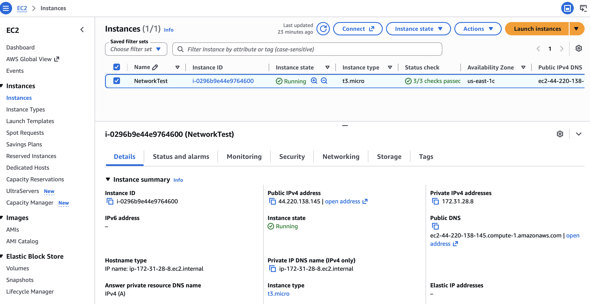
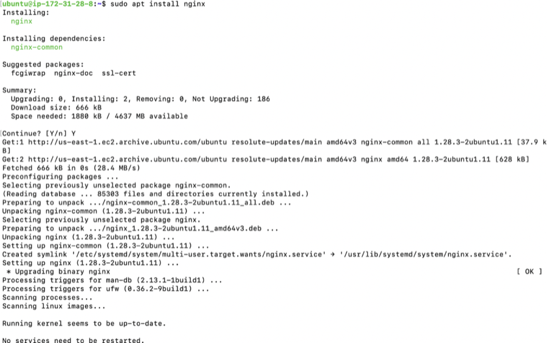
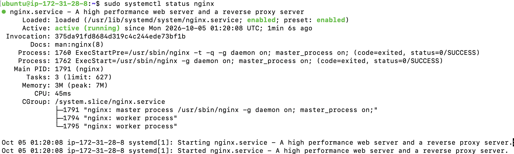
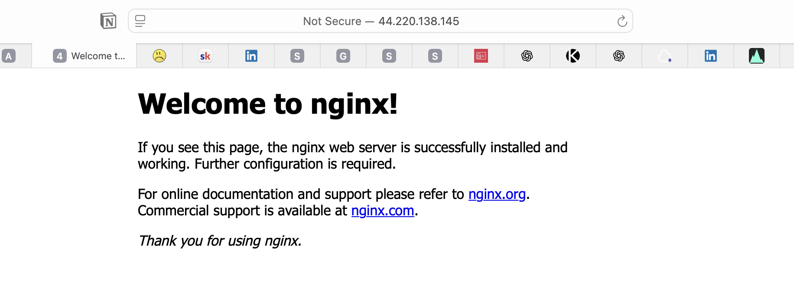
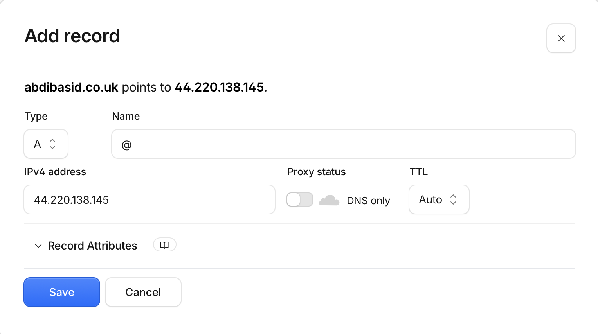
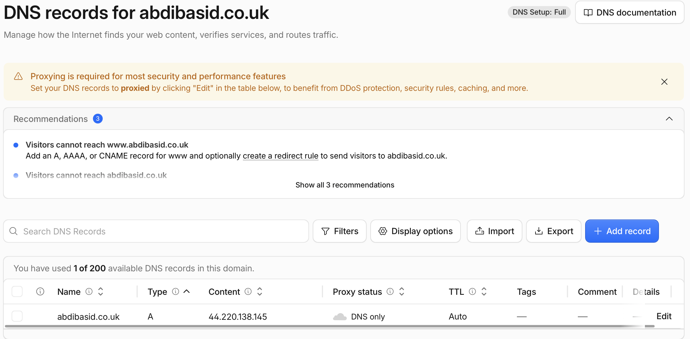

# Core Assignment — Deploying NGINX on AWS EC2 with a Custom Domain

## Overview

In this assignment, I deployed an NGINX web server on an AWS EC2 instance and connected my custom domain to the server using Cloudflare DNS.

The purpose of the assignment was to understand how several networking components work together when a user accesses a website:

- DNS
- Public IP addresses
- Ports
- AWS Security Groups
- EC2
- NGINX
- HTTP

The final request flow looks like this:

```text
Browser
   |
   | http://abdibasid.co.uk
   v
Cloudflare DNS
   |
   | Resolves domain to EC2 public IPv4 address
   v
EC2 Public IP
   |
   | HTTP request on port 80
   v
AWS Security Group
   |
   | Allows inbound port 80
   v
NGINX
   |
   | Returns HTTP response
   v
Browser
```

---

## 1. Creating the EC2 Instance

I created an Ubuntu EC2 instance in AWS to act as the server that would run NGINX.



The EC2 instance was assigned both a **private IPv4 address** and a **public IPv4 address**.

The private IP is used for communication within the AWS network, while the public IP allows the instance to be reached over the internet.

### Security Group

I configured the EC2 Security Group to allow inbound traffic on:

- **Port 22 — SSH**
- **Port 80 — HTTP**

Port 22 allowed me to remotely connect to and manage the Ubuntu server using SSH.

Port 80 allowed HTTP requests from the internet to reach the NGINX web server.

The Security Group acts as a firewall, controlling which inbound network traffic is allowed to reach the EC2 instance.

#### Troubleshooting the Security Group

One issue I encountered was accidentally changing the existing SSH rule from **port 22 to port 80**.

This meant I had replaced the SSH rule rather than creating an additional rule. Without port 22 being allowed, new SSH connections to the EC2 instance would be blocked.

I realised that SSH and HTTP required **separate inbound rules**, so instead of modifying the existing rule, I added another rule for HTTP.

The final configuration therefore had:

- **Port 22 → SSH**
- **Port 80 → HTTP**

This helped me understand that a Security Group can contain multiple rules, with each rule allowing a different type of network traffic to reach the instance.

### Connecting to the EC2 Instance with SSH

After launching the instance and allowing SSH traffic on port 22, I connected to the Ubuntu server from my local terminal.

Before connecting, I changed the permissions of my EC2 private key:

```bash
chmod 400 "NetworkingTest.pem"
```

This gives the file owner read permission while removing permissions for group and other users. SSH requires private keys to have appropriately restrictive permissions.

I then connected to the EC2 instance using SSH:

```bash
ssh -i "NetworkingTest.pem" ubuntu@<EC2-PUBLIC-DNS>
```


The SSH command contains several important parts:

```text
ssh
 |
 | Secure Shell connection
 v

-i NetworkingTest.pem
 |
 | Use this private key for authentication
 v

ubuntu@EC2-PUBLIC-DNS
   |          |
   |          └── Address of the EC2 instance
   |
   └── User to log in as
```

This gave me remote terminal access to the Ubuntu operating system running on the EC2 instance.

From this point, commands entered into the SSH session were being executed on the EC2 server rather than on my local Mac.

---

## 2. Installing NGINX

After connecting to the EC2 instance through SSH, I updated the Ubuntu package list:

```bash
sudo apt update
```

I then installed NGINX:

```bash
sudo apt install nginx
```



### Verifying the NGINX Service

After installing NGINX, I checked the status of the service using:

```bash
sudo systemctl status nginx
```



The output showed:

```text
Active: active (running)
```

This confirmed that NGINX was running successfully as a service on the EC2 instance.

The status output also showed the NGINX processes currently running on the server, including the master process and worker processes.

This gave me two different ways of verifying the web server:

1. **Server-side check** — `systemctl status nginx` confirmed that the NGINX service was running.
2. **Client-side check** — opening the EC2 public IP in my browser confirmed that NGINX was reachable over the network and responding to HTTP requests.

These tests check different parts of the setup. A service could be running correctly on the server while still being unreachable externally because of a networking or firewall configuration problem.

NGINX is the web server running on the EC2 instance.

For this assignment, NGINX listens for HTTP requests on **port 80** and returns a web page to the client making the request.

---

## 3. Testing NGINX Using the Public IP

Before configuring DNS, I tested the web server directly using the EC2 instance's public IPv4 address.

I entered the public IP into my browser and received the default NGINX page.



Seeing the **Welcome to nginx!** page confirmed that:

1. The EC2 instance was running.
2. The instance was reachable over the internet.
3. The Security Group allowed inbound HTTP traffic on port 80.
4. NGINX was installed and running.
5. NGINX was responding to HTTP requests.

At this stage, DNS was not involved because I accessed the server directly using its IP address.

The request was essentially:

```text
Browser
   |
   | HTTP request
   v
EC2 Public IP : Port 80
   |
   v
NGINX
   |
   v
HTTP Response
```

---

## 4. Configuring DNS with Cloudflare

Once I confirmed that the server worked through its public IP address, I configured DNS for my domain using Cloudflare.

I created an **A record** for the root domain.



The record was configured using:

```text
Type:   A
Name:   @
Target: EC2 Public IPv4 address
Proxy:  DNS only
TTL:    Auto
```

### A Record

An **A record** maps a hostname to an IPv4 address.

Conceptually:

```text
abdibasid.co.uk
        |
        | DNS A record
        v
EC2 Public IPv4 Address
```

This allows users to enter the domain name instead of having to remember the server's IP address.

### Root Domain (`@`)

The `@` value represents the root domain itself.

In this case, it means:

```text
abdibasid.co.uk
```

rather than creating a subdomain such as:

```text
networktest.abdibasid.co.uk
```

### DNS Only

I configured the Cloudflare record as **DNS only**.

This means Cloudflare is being used to answer the DNS query, but Cloudflare is not proxying the HTTP traffic.

The browser therefore receives the EC2 public IP from DNS and then connects directly to the EC2 server.

### TTL

TTL stands for **Time To Live**.

It determines how long DNS resolvers may cache a DNS answer before requesting it again.

For this assignment, I left TTL set to **Auto**.

After saving the configuration, the DNS record appeared in Cloudflare:



---

## 5. Testing the Domain

After configuring DNS, I tested the setup again.

This time, instead of entering the EC2 public IP into the browser, I entered:

```text
http://abdibasid.co.uk
```

The NGINX page successfully loaded through my domain.


This confirmed that the complete request path was working:

```text
User enters abdibasid.co.uk
            |
            v
      DNS lookup occurs
            |
            v
       Cloudflare DNS
            |
            | A record
            v
    EC2 Public IPv4
            |
            | HTTP :80
            v
    AWS Security Group
            |
            | Port 80 allowed
            v
          NGINX
            |
            | HTTP response
            v
          Browser
```

---

## HTTP and "Not Secure"

The browser displays **Not Secure** because the website is currently being served using HTTP rather than HTTPS.

The current setup uses:

```text
HTTP → Port 80
```

HTTP does not encrypt the communication between the browser and the server.

HTTPS would instead use TLS encryption and normally communicate over:

```text
HTTPS → Port 443
```

HTTPS/TLS configuration was outside the scope of this assignment.

---

## Result

The core assignment was successfully completed.

During the assignment, I:

- Launched an Ubuntu EC2 instance.
- Connected to the EC2 instance using SSH.
- Configured Security Group inbound rules.
- Allowed SSH traffic on port 22.
- Allowed HTTP traffic on port 80.
- Installed NGINX on Ubuntu.
- Verified NGINX using the EC2 public IP.
- Created an A record using Cloudflare DNS.
- Pointed my root domain to the EC2 public IPv4 address.
- Verified that the domain successfully reached the NGINX server.

The completed architecture is:

```text
                Internet
                   |
                   v
         +-------------------+
         |  Cloudflare DNS   |
         +-------------------+
                   |
             A Record
                   |
                   v
         EC2 Public IPv4
                   |
                   v
        +--------------------+
        |   Security Group   |
        |                    |
        |  22  → SSH         |
        |  80  → HTTP        |
        +--------------------+
                   |
                   v
         +-------------------+
         |    EC2 Ubuntu     |
         |                   |
         |      NGINX        |
         |      :80          |
         +-------------------+
                   |
                   v
             HTTP Response
                   |
                   v
                Browser
```

This assignment demonstrated how DNS, IP addresses, ports, firewalls, cloud servers and web servers work together to make a website accessible through a domain name.
